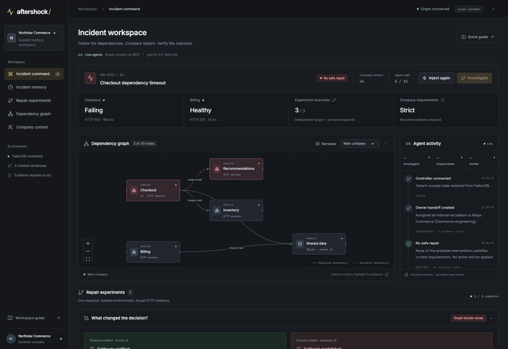
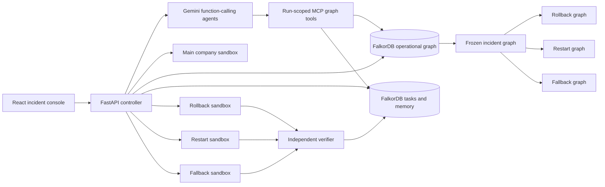

# AFTERSHOCK

**Agents that test three futures before choosing a repair.**

AFTERSHOCK investigates a failing miniature commerce company, forks its FalkorDB operational graph, and tests three repairs against isolated working HTTP services. It verifies the best repair, applies it to the main sandbox, and remembers the outcome. Changing a company requirement invalidates the remembered repair on the next incident.

The graph determines the candidate set: connected runbooks suggest repair nodes, and current owner-approved project decisions determine whether a bypass is permitted. Agents discover and call real MCP tools to retrieve this context. Verified recoveries become reusable procedures with explicit preconditions, rather than just a transcript of the last incident.

**[Watch the demo on YouTube](https://www.youtube.com/watch?v=2ulhyU0_OrA&t=110s)**



*The second incident: a changed company policy blocks the previously successful repair, while Billing remains healthy.*

## FalkorDB at the center

| Capability | What it changes in AFTERSHOCK |
| --- | --- |
| Multi-hop Cypher and native `algo.bfs` | Follow service dependencies into affected workflows and customer groups. |
| Native `shortestPath` | Explain connections between an owner, a sourced decision, and a project. |
| Full-text and native vector indexes | Retrieve runbooks, tickets, chats, and prior experience using real Gemini embeddings plus lexical matches. |
| `GRAPH.COPY` | Give every experiment a separate copy of the same frozen incident context. |
| Persistent graph memory | Store episodic outcomes, semantic facts, learned procedures, public agent dialogue, and task handoffs. |
| Range indexes and conditional updates | Look up stable IDs and claim renewable task leases through the graph. |

Removing a runbook's `SUGGESTS` connection removes that repair from discovery. Missing approval evidence blocks fallback. A superseding decision invalidates an earlier successful procedure. The graph therefore changes the agent's available actions, eligibility checks, and next handoff.

## Start

Prerequisite: Docker Desktop running with Compose v2, approximately 4 GB available memory, and internet access for the first build. Host Python and Node are not required.

```sh
cp .env.example .env
# Privately add a free Google AI Studio key as GEMINI_API_KEY in .env.
docker compose up --build -d
```

Open **http://localhost:8000**. API documentation: http://localhost:8000/docs.

The default mode is **live**. `GEMINI_MODEL` is configurable; the default is `gemini-3.5-flash-lite`. Model availability and free-tier quotas depend on the account. A missing key or quota failure pauses the investigation with an explicit message; it never produces simulated live output. API keys remain server-side.

`GEMINI_EMBEDDING_MODEL` defaults to `gemini-embedding-001`, producing normalized 768-dimensional embeddings cached in FalkorDB. Embedding requests are separate from the 12 generation requests allowed per incident. If embeddings are disabled or unavailable, retrieval reports its full-text-only state explicitly. Eligibility and verification continue to require graph evidence. Set `EMBEDDINGS_ENABLED=false` to use lexical retrieval intentionally.

For a model-free, clearly labeled rehearsal:

```sh
AGENT_MODE=rehearsal docker compose up --build -d
```

Rehearsal mode uses a deterministic agent adapter. FalkorDB, graph copies, service processes, interventions, requests, and verifier results are still real. The mode is disclosed in the console and recording. To return to live mode, set `AGENT_MODE=live` in `.env` and recreate the API container.

## Try the complete story

1. Initialize the company; observe healthy checkout and billing requests.
2. Inject the recommendations timeout, then click **Investigate**.
3. Inspect each experiment: rollback runs the actual checkout v1 process and fails its schema check; restarting data interrupts billing; fallback restores checkout.
4. Apply the verified repair. The main environment independently checks checkout and billing again.
5. Open incident memory; optionally run `docker compose restart api` and see it persist.
6. Expand **Company brain** to inspect the connected ticket, chat, decision sources, and owner → decision → project path. Open memory to inspect the learned procedure and public MCP dialogue.
7. Enable **Mandatory recommendations**, inject the incident again, and investigate. The previous bypass is rejected by the superseding owner-approved decision. No available repair is applied; the graph records an internal escalation to the responsible owner.

The workspace selector switches between **Northstar Commerce** and **Harbor Retail**. Each has its own operational graphs, incidents, conversations, embeddings, procedures, and task leases. A signed HttpOnly session binds requests to the selected scope; agents inherit that scope through MCP.

One executable sandbox pool is active at a time. Switching workspaces saves the departing company's SQLite/configuration snapshot and restores the arriving company's state. An active investigation prevents switching. Other workspace sessions can still inspect their own graph and memory, while runtime operations require ownership of the pool. Reset archives the selected run and retains its incident experience. Restarting Docker preserves graph, session-signing state, and sandbox volumes. `docker compose down` stops the app without deleting volumes; `down -v` deletes its data.

Expand **What changed the decision?** to compare a measured recovery's frozen graph with today's requirements. It distinguishes a current graph prohibition from a newly observed rejection. **Deployment & migration provenance** connects DEP-481, the incompatible schema migration, its project, release source, and approving owner; the investigator and rollback verifier query this path.

The console is a local operator demonstration: its operator can explicitly activate either synthetic workspace. Signed scope binding and separate graphs prevent accidental or forged cross-scope queries; they do not provide a production user directory or role-management service.

## Focused tenant and coordination check

```sh
docker compose exec -T api python -m aftershock.check_coordination
```

This uses disposable graphs on real FalkorDB: eight workers make simultaneous scoped reads and persist 32 messages; eight contenders race for one task; a replacement reclaims an expired lease and resumes its handoff. It also checks foreign run/graph rejection and MCP scope enforcement. The disposable graphs are removed, and the measured report appears under **Incident memory → Memory isolation & handoffs**. This is a functional check, not a throughput benchmark; it calls no model and does not touch running sandbox services.

## How it works



Each sandbox contains separate checkout, recommendations, inventory, billing, and data-service processes plus a bounded supervisor. Each has its own SQLite database. Services call one another over HTTP. The API has no Docker socket and accepts no arbitrary shell commands or Cypher from agents.

Operational graph and application snapshots are captured at the same company version while external mutations are blocked. SQLite's backup API produces the database snapshot. A SHA-256 checksum binds it to the supervisor configuration. Each experiment restores that bundle and changes only its own graph and processes.

The investigator retrieves evidence and proposes interventions; the coordinator runs parallel experiments; the verifier reviews observations. Deterministic acceptance rules remain authoritative. Billing must remain healthy throughout the experiment, and the final three checkout probes must pass. Current graph policy and compatibility requirements must also pass.

The MCP server exposes seven bounded read tools. The controller discovers their schemas through `list_tools` and invokes them over stdio. Action proposals and execution remain validated controller operations. Tools cannot accept arbitrary Cypher, shell commands, or another run's graph name. See [MCP tools and connection](docs/mcp.md).

Task leases, handoffs, observations and events persist in FalkorDB. Startup resumes an interrupted investigation; another controller can reclaim a task after its 90-second lease expires. Application keys prevent duplicate completed repairs. The supplied successful action is an idempotent fallback setting.

## AI Disclosure
AI tools, including Codex, assisted with implementation, debugging, interface design, testing, and documentation. I directed the project, reviewed the generated work, and understand the architecture, graph model, and code. Gemini powers the agents during live investigations.
