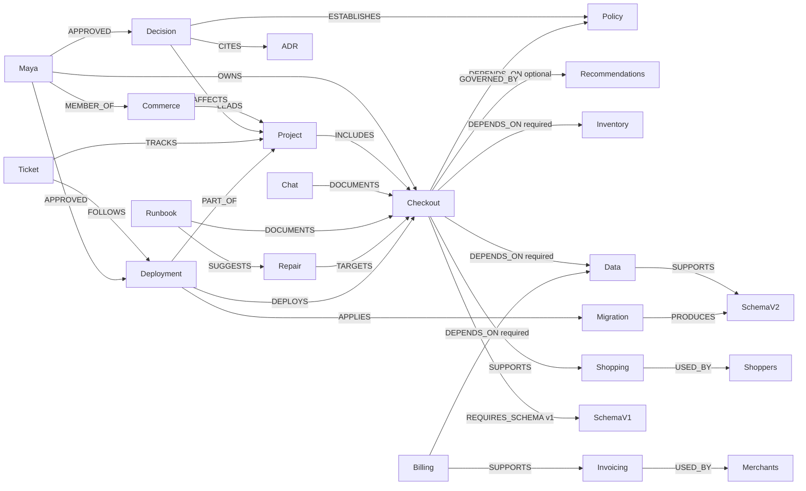

# Graph model

FalkorDB is required at runtime. There is no in-memory graph fallback. SQLite belongs to the synthetic company and stores its orders and invoices; it does not replace the operational graph or incident memory.

## Operational graph

Stable IDs identify `Service`, `Schema`, `Workflow`, `CustomerGroup`, `Person`, `Team`, `Project`, `Document`, `Decision`, `Repair`, `Policy`, `Deployment`, and `Migration` nodes. Fixture nodes and relationships include source references into `fixtures/northstar.json`. Policy updates create new source documents and superseding decisions, preserving earlier evidence.

`DEPENDS_ON.required`, the governing policy, and a current owner-approved project decision must all permit bypass. The approval path must include its source document. Rollback requires an explicitly matching schema. Missing evidence blocks verification. Older chats remain retrievable but cannot override the current decision.

Candidate discovery follows `checkout ← DOCUMENTS — runbook — SUGGESTS → Repair — TARGETS → Service`. Only connected, enabled repairs with allowlisted executors are available. There is no hardcoded three-action proposal returned to the model. Native `algo.bfs` retrieves reachable dependencies; bounded directed `shortestPath` explains entity connections. These paths represent evidence connections, not causal proof.

Documents have native full-text indexes on text and name, plus a 768-dimensional cosine vector index. Real `gemini-embedding-001` document and query embeddings are normalized and cached by model, task type, and text hash. Retrieval ranks dual-channel matches first and reports both channels. FalkorDB 4.18 returns cosine distance; the UI-facing similarity is `1 - distance`. Failed embedding access produces an explicit lexical fallback.

The company graph is copied once per incident into a frozen snapshot, then copied three more times with `GRAPH.COPY`. Each candidate changes only its own copy. Graph topology predicts potentially affected workflows and customer groups; it does not establish runtime causality.

## Coordination and memory

Each tenant's separate memory graph stores `Control`, `Run`, `Task`, `Event`, `Incident`, `Snapshot`, `Experiment`, `Action`, `Observation`, `Application`, `Outcome`, `Procedure`, `SemanticFact`, `MemoryEntry`, `Message`, `Decision`, `Escalation`, `PersonRef`, and `Environment` nodes. Runs have events and public messages; incidents have experiments; experiments test actions and have observed samples. Task payloads preserve role handoffs. Snapshot metadata includes the company version, application configuration, SQLite backup, and SHA-256 checksum.

The internal registry graph holds sandbox ownership, the server-side session-signing key, and the measured coordination-check report. Tenant tools cannot query this graph. See [workspace isolation and decision provenance](workspaces.md) for scope binding and executable-state switching.

An incident stores a verified outcome after application, or an unresolved outcome after all candidates fail. Full-text memory retrieval finds previous checkout/recommendations incidents. Typed `MemoryEntry` nodes add vector retrieval across episodic and procedural experience.

A verified main-environment recovery creates a `Procedure — LEARNED_FROM → Outcome` with a `REQUIRES → SemanticFact` precondition. Confirmation counts refer to distinct incidents. Retrieval rechecks procedures against the current operational graph; a mandatory-policy decision explicitly invalidates fallback procedures. Successful procedures influence candidate ordering but never skip isolated execution or verification.

Public model messages and MCP inputs/results persist as `Message` nodes; private model thought/signature fields are excluded. Task restart uses completed graph handoffs and current context instead of assuming the original conversation still exists. Per-experiment `Decision — BASED_ON → Experiment` records make acceptance and rejection inspectable. An unresolved incident creates an internal `Escalation — ASSIGNED_TO → PersonRef`, selected from current service ownership. This records an assignment; it does not send an external message.

Range indexes cover stable IDs used for coordination and company lookups, and `Message.run_id`. The company-context endpoint exposes a native query execution plan so an indexed service lookup can be inspected.

The decision comparison reads policy/approval facts from the previous recovery's immutable incident snapshot and today's company graph. It preserves the original HTTP samples, lists the changed facts, and reports a current observed verdict only when the experiment version matches the company version. Deployment lineage adds the migration's source, project, owner approval, and produced schema to rollback eligibility evidence.

Task claims are conditional Cypher updates with a 90-second lease and 20-second renewal. Completed task payloads are reused. Interrupted experiment work is restored from the original snapshot and retried. Application keys are per incident; the only passing repair in the provided scenarios is an idempotent configuration change.

## Essential queries

See [queries.cypher](queries.cypher). Executed versions live in `aftershock/graph.py` and `aftershock/knowledge.py` and accept parameters. Agents discover bounded tools through the real MCP transport; they cannot submit arbitrary Cypher. The UI exposes prediction queries, evidence IDs, source documents, owner/decision paths, snapshot provenance, HTTP statuses, and actual process IDs.

## Persistence

FalkorDB uses append-only persistence with `appendfsync everysec` on the `graph-data` Docker volume, plus periodic snapshots. A controller restart preserves graph state. An abrupt host/storage failure can lose the last second of acknowledged writes; this hackathon implementation is a single-controller application, not a production HA system.
