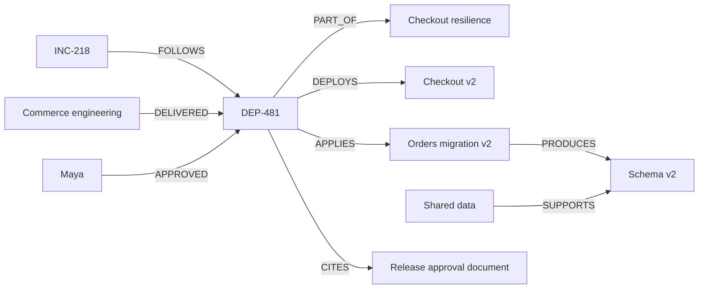

# Workspace isolation and decision provenance

## Bound tenant scope

The local console provides Northstar Commerce and Harbor Retail as synthetic workspaces. Northstar retains the original `aftershock_memory` and `aftershock_company_*` names so existing evidence is preserved. Harbor uses `aftershock__tenant_harbor_memory` and `aftershock__tenant_harbor_company_*`.

Every request receives a server-bound store/controller from an HMAC-signed HttpOnly, SameSite=Strict cookie. The signing key is generated once and persisted in the internal registry graph; it is never returned to the client or included in source. Tenant headers and query parameters cannot choose a graph. Foreign run IDs return 404, invalid sessions return 401, and browser mutations require the same origin.

API clients first call `GET /api/config` and retain the returned cookie. The browser does this automatically. When another tab changes the selected workspace, the console reloads its views and clears the previously displayed context.

`GraphStore.require_graph` restricts queries, graph copies, and deletion to the bound memory graph or its company/experiment graph prefix. MCP processes inherit the trusted base prefix and tenant ID from the controller. A foreign run ID fails inside the MCP server before evidence can be returned. Conversation history, full-text/vector memory, embedding caches, procedures, decisions, task leases, and application keys all use the scoped memory graph.

This is a local operator console. Workspace activation deliberately lets the operator switch between both demo companies. The session and graph boundaries provide data partitioning and request binding; they are not a production identity provider or a claim that an authorized local operator cannot select the other workspace.

## Executable state

One shared pool of four sandbox containers is retained. The registry stores its current owner. A shared controller lock serializes runtime mutations, observations, and workspace switching. A running investigation blocks transfer of the pool.

Before a transfer, the source tenant stores a SQLite/configuration backup with its run ID and company version. The target must have a matching saved bundle, or no active company. The supervisor restores the target bundle, preserving independent company data and policy. If restoration fails, the previous bundle is restored when available; an uncertain owner disables execution until recovery. Inactive tenants can inspect their stored context and memory but cannot operate or probe another company's runtime.

## Decision comparison

The comparison finds the most recent verified fallback outcome within the current tenant. Its incident points to a frozen `GRAPH.COPY` snapshot. That historical graph supplies the original dependency, governing policy, approval, and source document. The current company graph supplies today's equivalents.

The API reports the actual changed facts and whether they changed eligibility. Historical successful HTTP samples remain attached to the baseline. A current experiment verdict appears only when its company version matches; otherwise the view explicitly reports a graph check awaiting new runtime evidence. A policy update marks earlier experiments stale, clears the recommendation, and requires a fresh incident before investigation/application.

## Deployment lineage

The reproducible deployment fixture connects:

Rollback verification requires current deployment provenance and checks the migration-produced schema against the actual declared data-service support. The real checkout v1 process independently fails against schema v2. The graph explains the constraint; HTTP execution establishes the result.

## Reproduce the focused check

Run `docker compose exec -T api python -m aftershock.check_coordination`. It creates disposable tenant graphs, checks scoped memory and MCP access, performs eight concurrent readers/writers, races eight distinct task owners, waits for lease expiry, rejects the previous owner's write, and restores the completed handoff through a fresh store instance. It publishes the measured summary to the internal registry and removes the temporary graphs. It does not call Gemini or alter company sandboxes.
